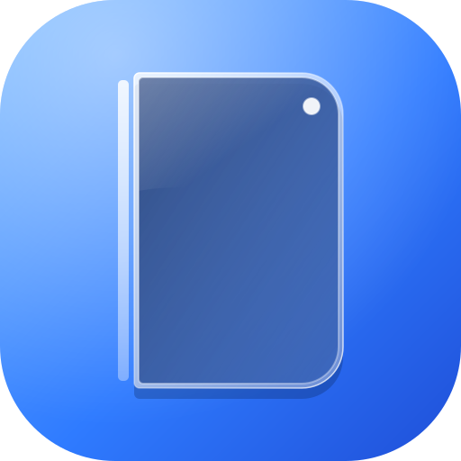

# iPhone Duo App Tracker

**Which apps are ready for iPhone Duo?**
A free, independent, daily-updated list of apps that support Apple's foldable iPhone, across ten App Store markets.

### [duoapptracker.com](https://duoapptracker.com/)

---

## What it is

iPhone Duo apps are listed on the App Store, but there is no single place to see which ones have been updated for the folding screen. This site collects them in one list, with **the date each app added support** and **how we know it supports iPhone Duo**.

- **Ten markets:** India, United States, United Kingdom, UAE, Singapore, Australia, Canada, Germany, Japan and China. Pick a market to see every listed app on that store, with that market's rating and store link.
- **Every app shows its proof:** a green dot means the app's own update notes mention iPhone Duo. An amber dot means it was reported by Apple, the press or the site owner, with a link where there is one.
- **Filter and search:** by market, category, who confirmed it, when it was added, and by app or developer name.
- **Light and dark** themes, and a phone-friendly layout.
- **Remind me:** on the site, add an app that is not ready yet and the page flags it on your device once it is.
- **App missing?** Tell us an app we have not listed. No account needed.

## How it works

1. A scan reads Apple's public App Store charts and store pages for the ten markets.
2. For each app it reads the version history and keeps the app if a version since September 2026 mentions iPhone Duo or its folding screen.
3. Apps that support iPhone Duo without saying so in their notes are added from reports (Apple's own iPhone Duo collections, MacRumors, and apps the owner has tested on a real device). These are dated by their last App Store update.
4. A GitHub Action runs the scan **three times a day** (about 7:00 am, 1:00 pm and 9:00 pm India time) and saves the new list. The site is plain HTML and one data file, hosted free on GitHub Pages. There is no server, no tracking and no sign-in.

## Repository

| File | What it is |
|---|---|
| `index.html` | The whole website (page, styles and script) |
| `data.json` | The app list, rewritten by each scan |
| `duo_cloud.py` | The scan: reads App Store charts, store pages and version history |
| `reported_manual.json` | Apps reported by hand, with their source |
| `watch.json`, `submissions.json` | The owner's watch list and visitor suggestions |
| `.github/workflows/` | `refresh.yml` (the scan) and `collect.yml` (collects suggestions every 3 hours) |
| `icon.svg`, `og-image.png` | Logo and link-preview picture |

## Missing an app?

Use **App missing?** on the site and type the app's name. The next scan checks the app's update notes and adds it only if they say it supports iPhone Duo. If you have a GitHub account you can also [open a report](https://github.com/duoapptracker/duoapptracker.github.io/issues/new?template=share-an-app.yml).

## Good to know

- The list is built automatically, so it can **miss apps or include one by mistake**. Check an app's App Store page before relying on it.
- Apple's "Made for iPhone Duo" badge and the SDK version an app was built with are not in the public data, so they are not shown.
- This is a temporary project: it is most useful while apps are still being updated. When most apps support iPhone Duo it will be wound down.

## About

Built and maintained by **Vishnu Rajkumar** · [@Vishnuraajkumar on X](https://x.com/Vishnuraajkumar)

If the tracker helps you, a ★ on this repository is welcome.

© 2026 Vishnu Rajkumar. Free to use.

## Disclaimer

This is an independent project. It is not affiliated with, endorsed by or sponsored by Apple Inc. iPhone and App Store are trademarks of Apple Inc. App names and icons belong to their owners.
